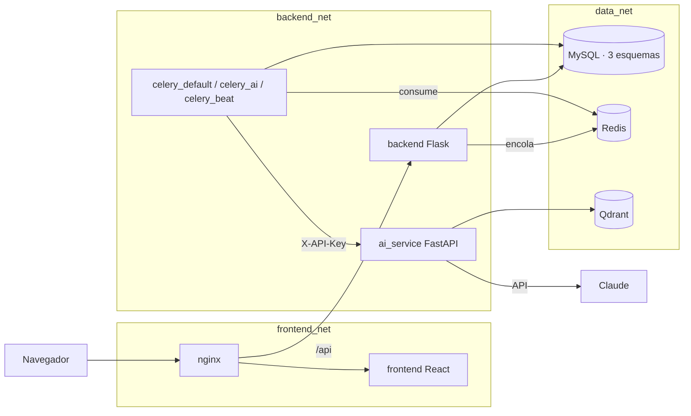
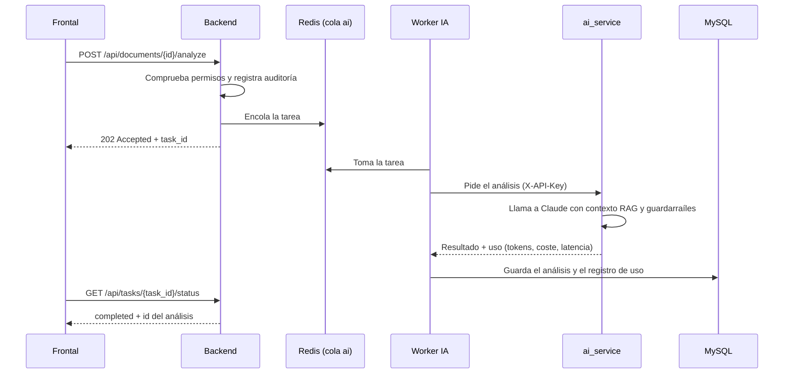

# Arquitectura

La Plataforma separa la lógica de negocio, la IA y los frontales en servicios distintos,
porque tienen tiempos de respuesta, consumo de recursos y ciclos de despliegue muy
diferentes. Las razones de cada elección están en [`adr/`](adr/).

## Del proceso al componente

| Paso del proceso | Componente |
| --- | --- |
| P1 Recepción de documentos | `backend` (subida, versionado) + `celery_ai` (extracción de texto; OCR más adelante) |
| P2 Análisis | `ai_service` (Claude) + `qdrant` (contexto RAG), lanzado desde la cola `ai` |
| P3 GO/NO-GO | `backend` lee el análisis persistido y registra la decisión humana |
| P4 Similares | `qdrant` (búsqueda semántica) |
| P5 Perfiles | `qdrant` (CV vectorizados) + `ai_service` (puntuación) |
| P6 Propuesta | `ai_service` (borrador) + `backend` (secciones, revisión, exportación) |
| P7 Carga en portales | `celery_automation` + Selenium en `rpa_net` (más adelante) |
| P8 Oportunidades | `celery_beat` + `meilisearch` (fase 5b) |

## Capas y redes

- Solo `nginx` publica un puerto. `ai_service`, MySQL, Redis y Qdrant no son accesibles desde fuera.
- `frontend_net`: proxy y frontales. `backend_net`: proxy, backend, IA y workers. `data_net`: datos.
- Cuando llegue la automatización, `celery_automation` estará en `backend_net` y en una red
  `rpa_net` con Selenium, **sin** acceso a `data_net`.

## Flujo de una operación de IA

El backend nunca espera a Claude. Para el chat, donde el usuario quiere ver la respuesta
mientras se genera, el backend hace de pasarela del streaming SSE de `ai_service` y lleva
el bucle del agente: ejecuta las herramientas con los permisos de la persona y se para a
pedir aprobación antes de cambiar nada (ADR-013).

Opcionalmente (`LLM_GATEWAY_ENABLED=true`), `ai_service` no llama a Anthropic sino al
gateway LLM corporativo (`platia-gateway`), por una red propia que solo comparte el
servicio de IA. El gateway guarda la clave del proveedor y audita cada llamada con su
tarea, su persona y el `correlation_id` de PLATIA (ADR-019).

## Crecimiento previsto

| Servicio | Cuándo entra | Motivo |
| --- | --- | --- |
| Núcleo de 8 contenedores | Fase 0 (hecho) | Base mínima que permite crecer sin reescribir |
| `celery_beat` | Fase 4 (hecho) | Tareas periódicas: limpieza RGPD, escaneo de datos personales, alertas |
| Workers por cola (`celery_default`, `celery_ai`) | Fase 4 (hecho) | Las tareas de IA no deben competir con las de documentos |
| `meilisearch` | Fase 5b (hecho) | Búsqueda textual rápida de oportunidades y documentos |
| ~~`analytics_frontend`, `admin_frontend`~~ | Fase 6 | Finalmente son dos entradas más del contenedor `frontend` (ADR-015) |
| `flower`, `certbot` (solo producción) | Fase 8 (hecho) | Estado de las colas tras nginx con contraseña; renovación de Let's Encrypt (ADR-016) |
| `celery_automation` + Selenium (hub y 3 nodos) | Posterior | RPA aislada en `rpa_net` |

## Producción

`docker-compose.prod.yml` se aplica encima de `docker-compose.yml`: imágenes de GHCR por
commit, nginx en 80/443 con HTTPS y HSTS, registros JSON rotados y Flower en `/flower/`.
Los despliegues los lanza GitHub Actions con aprobación y vuelven solos a la versión
anterior si la nueva no arranca sana. Guía en [despliegue.md](despliegue.md) y decisión en
[ADR-016](adr/ADR-016-despliegue-y-operacion.md).
